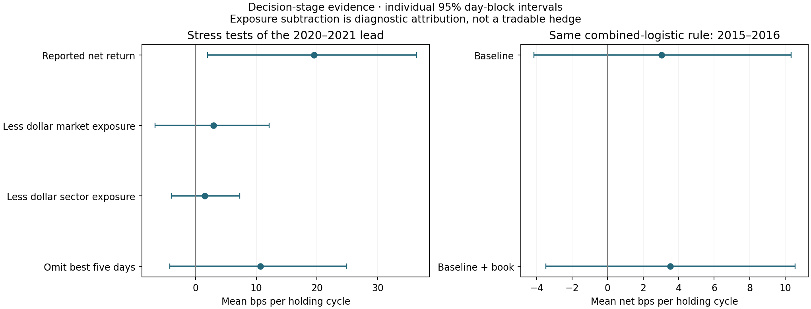

# Research decision memo — 21 October 2026

**Recommendation: stop the broad next-day snapshot-alpha search, and give Mihai a transparent negative research update rather than a discovery pitch.** There is a careful reconstruction here, but no validated incremental trading signal or established publishable contribution. Do not discard the work; use it to ask whether a narrowly scoped negative replication or measurement study is worthwhile. Continuing the same model search without a new mechanism and independent evaluation would be hard to justify.

This memo is for deciding what to tell Mihai, not for selecting the prettiest backtest. The original next-day question, the minute closing extension, Rigel's ranking proposal, relative-return forecasts, liquidity filtering and a separate risk pivot have now been tested. Prior positive-looking results are treated as exploratory, not as fresh validation.

## The apparent daily trading lead

The previously highlighted combined overnight-plus-day logistic top20 portfolio earned +19.51 bps after crossing spreads in 2020–2021. That number alone is not sufficient evidence of book alpha.

| Diagnostic | Mean bps/cycle | 95% day-block interval |
| --- | --- | --- |
| net_bps | +19.51 | [+2.01, +36.35] |
| market_adjusted_bps | +2.96 | [-6.64, +12.15] |
| sector_adjusted_bps | +1.51 | [-3.96, +7.30] |
| net_after_5bp_side | +9.51 | [-8.01, +26.36] |
| omit_best_5_days | +10.67 | [-4.24, +24.84] |
| omit_best_10_days | +4.47 | [-13.81, +20.24] |

The original result has unadjusted p≈0.030, but Holm p=1.000 across the 84 originally reported portfolio variants. This correction covers that documented family, not every adaptive research choice made in the project. Removing the five best days reduces the mean to +10.67 bps with an interval crossing zero; removing ten reduces it to +4.47 bps. These are ex-post concentration diagnostics, not alternative trading rules.

Dollar market attribution removes about 16.55 of the 19.51 bps; dollar sector attribution leaves about 1.51 bps. The market component decomposes into roughly 2.99 bps from average exposure and 13.56 bps from the covariance of changing exposure with market returns. Therefore this is not merely a constant long-market bet: common-return timing could in principle contain information. The subtraction does not prove that timing is spurious. It does show that a stock-specific ranking-alpha interpretation is unsupported. These benchmarks use realized same-universe outcomes and static sectors, not an executable hedged strategy, a beta-adjusted factor model or a causal alpha estimate.

## Separate earlier chronological experiment

We extracted 659,900 additional archived stock-days for 438 training-eligible stocks in 2011–2016. Universe eligibility uses at least 200 valid signal days in 2011, with no test-year coverage screen. The original archive's composition may still be survivorship-biased. Train 2011–2013, select the same two preset settings on 2014, refit through 2014, test 2015–2016. The protocol was fixed before inspecting these new test results. This is a separate earlier-period replication, not a prospective holdout or a guarantee that the original project never examined these dates.

For the original combined-logistic rule, the book increment in prediction loss is -0.143% (95% interval [-0.428%, +0.102%]; two-comparison Holm p=0.622). The top20 book-minus-baseline portfolio increment is +0.49 bps per cycle (interval [-3.40, +4.23]; Holm p=0.799).

| Model | Period | Days | Net bps/cycle | 95% interval | Mean net exposure |
| --- | --- | --- | --- | --- | --- |
| base | all | 493 | +3.05 | [-4.16, +10.33] | +0.52 |
| base | 2015 | 246 | +3.44 | [-4.63, +10.12] | +0.59 |
| base | 2016 | 247 | +2.65 | [-8.71, +16.95] | +0.45 |
| book | all | 493 | +3.54 | [-3.48, +10.56] | +0.58 |
| book | 2015 | 246 | +5.44 | [-3.21, +13.82] | +0.63 |
| book | 2016 | 247 | +1.64 | [-8.44, +12.77] | +0.53 |

Each increment compares book and baseline on identical observations within that comparison; loss inference uses 497 days and portfolio inference uses 493 common scorable days. The historical book portfolio becomes about −0.42 bps after dollar market attribution and −1.46 bps after dollar sector attribution; these remain diagnostic rather than executable hedges. A strategy's raw positive return is not sufficient if the baseline matches or exceeds it. Missing selected outcomes make a day unscorable, rather than cash or a replacement trade. Common complete-day evaluation remains a selection limitation. Overnight/combined returns are unadjusted price returns: absolute overnight log gaps >=0.20 are excluded, but dividends and corporate actions are not independently verified. Fees, impact, borrow and financing remain additional limitations.

## Pushes beyond raw-return forecasting

Relative-return targets subtract the same day's cross-stock target mean during training. This uses future information only to define labels; it never enters signal features. Models are ridge, spline ridge and logistic, each with matched baseline/book features. Four preset portfolio rules are top20 signed and long10/short10, unrestricted or limited to the lower half of signal-time spreads. Current spreads determine eligibility before future outcomes are inspected. Cash competes with the twelve book model/rule combinations per target on validation net return. No test outcome selects a winning rule.

| Period | Target | Validation choice | Test net bps/cycle | 95% interval | Book minus baseline bps [interval] |
| --- | --- | --- | --- | --- | --- |
| modern | combined | ridge / liquid_top20 | +11.15 | [-4.04, +26.72] | -4.11 [-10.02, +0.84] |
| modern | intraday | Cash | 0.00 | — | — |
| historical | combined | additive / top20 | +6.27 | [-0.53, +13.96] | +3.49 [+0.09, +7.02] |
| historical | intraday | Cash | 0.00 | — | — |

The historical validation-selected combined spline strategy has a small positive paired point estimate (+3.49 bps), with an individual interval just above zero, but its own net-return interval includes zero. Its centered two-sided paired bootstrap p is about 0.0505, and it does not survive correction across the 24 relative-return portfolio increments. None of those positive paired increments passes that correction in either period. This isolated result does not meet the joint requirements of beating cash, beating the baseline and repeating across periods. Portfolio mean tests cover 48 variants per period; paired increments cover 24.

The risk pivot separately predicts next-session log realized volatility, log price range and log mean spread. Baselines include current values and trailing own-history averages, in addition to the price/liquidity controls; both ridge and boosted trees are tested. Risk prediction is not trading alpha. The next session's risk quantities end at its 15:50 feature cutoff.

Below, positive percentages mean reduced loss from adding book features. Regression loss is MSE, including log-risk MSE; classification loss is log loss. Each six-test relative-return or risk family receives its own Holm correction within each period. These separate families are exploratory and are not a universal correction for the entire research history.

| Question | Target | Family | 2020–2021 increment | 2015–2016 increment |
| --- | --- | --- | --- | --- |
| relative | intraday | ridge | -0.007% (p=1.000) | +0.002% (p=1.000) |
| relative | intraday | additive | -0.004% (p=1.000) | -0.000% (p=1.000) |
| relative | intraday | logistic | -0.025% (p=0.032) | -0.006% (p=0.486) |
| relative | combined | ridge | +0.002% (p=1.000) | +0.016% (p=0.171) |
| relative | combined | additive | +0.002% (p=1.000) | +0.014% (p=0.171) |
| relative | combined | logistic | -0.034% (p=0.012) | +0.010% (p=0.825) |
| risk | vol | ridge | +0.234% (p=1.000) | -0.090% (p=1.000) |
| risk | vol | boost | -1.692% (p=0.012) | -0.043% (p=1.000) |
| risk | range | ridge | +0.586% (p=1.000) | +0.027% (p=1.000) |
| risk | range | boost | -0.650% (p=0.137) | -0.019% (p=1.000) |
| risk | spread | ridge | -1.201% (p=1.000) | +0.011% (p=1.000) |
| risk | spread | boost | +1.172% (p=1.000) | +0.084% (p=1.000) |

Full yearly estimates, all portfolio variants and their corrected tests are included in the compact result tables. [Risk-versus-persistence results](full_study/decision/risk_vs_persistence.csv) check whether the fitted risk forecasts beat simply carrying today's value forward. A positive result in only one period or one selected model is not cross-period validation.

## Does the minute closing result offer a distinct fallback?

A new diagnostic replays the original saved 2019 baseline/book forecasts. Within each stock-day, core and close are matched on stock-specific training-defined spread terciles, trailing volatility terciles and depth halves. Identical common-bin weights retain about 91.5% of eligible closing observations across 118,814 stock-days.

The matched queue increment is approximately 0.564% relative MSE improvement in core hours and 0.609% at the close. The difference is **0.045 percentage points**, with an individual interval approximately [−0.0003, +0.0912] points and p≈0.055, versus the earlier unmatched 0.110-point headline. On a common error denominator the absolute-loss benefit is larger near the close and its interval is positive; that is a different estimand and does not restore a robust relative closing advantage. Matching is an exploratory conditioning exercise, not a causal design or a new independent period. The previously demonstrated one-minute-delay collapse and spread-cost losses still apply.

Thus the short-horizon queue signal remains real in the tested sample, but a distinctive closing-session story is weaker after addressing composition and error scaling. This should not be presented as a validated profitable strategy or as an established novel mechanism.

## What to communicate to Mihai

The substantive update is: minute queue information is measurable but short-lived; ranking and a broader daily model search did not establish incremental net alpha; the one attractive daily backtest weakened under exposure, multiple-testing and separate-period checks; and controlling liquidity conditions weakened the distinctive closing advantage. This is a snapshot adaptation, not a failed exact replication or a refutation of his event/trade-based results.

Ask whether that negative/measurement result answers a worthwhile question for his group, or whether to close this direction and choose a different problem. Do not ask him to validate a claimed profitable strategy. A useful meeting and a publishable positive paper are different thresholds; this work supports the former, not the latter.

## Novelty and what would justify continuing

The [targeted literature review](DECISION_LITERATURE.md) finds direct prior work on daily imbalance/market-excess returns, order-book forecasting of volatility and liquidity, and imbalance volatility. A change of estimator, horizon or snapshot aggregation is not by itself an original contribution. Minute queues cannot reproduce event-type OFI or trade-co-occurrence labels.

The decision standard is evidence beyond matching controls, repeatability across periods, robustness to costs/exposure/concentration, and a narrow contribution distinguishable from prior work. The responsible discussion with Mihai should separate: (1) a careful reconstruction and negative directional-alpha result; (2) any explicitly exploratory feature of the tables above; and (3) a new research question that would need his judgment. “We found a profitable OFI strategy” is not supported by the original +19.51 bps backtest.

Do not keep enlarging the model search on 2020–2021 to manufacture a winner. A fresh hypothesis suggested by these diagnostics needs an independent evaluation plan; a risk pivot needs its own novelty and utility case. This work is informative even if the correct decision is to stop the current daily snapshot-alpha route.

## Audit and reproducibility

All 31 research tests pass. The 50 new saved final models replay 3,050 test predictions with maximum absolute discrepancy 1.8e-15. Extraction is sequential with a 600 MB per-stock temporary-data cap; numerical fits use one thread. Raw archives are preserved. Models, individual forecasts, full panels and per-stock provenance stay local; source, protocols and compact summaries can be shared on the existing research branch.

Run `historical_daily.py`, `decision_audit.py`, `decision_models.py modern`, `decision_models.py historical`, `closing_match.py`, `historical_attribution.py`, `verify_decision.py`, the test suite, then `report_decision.py`. Existing fitted outputs are reused: isolate stale outputs before changing a specification. The earlier next-day extraction and minute-study caches must already exist. Source hashes are saved in the decision implementation manifest.

