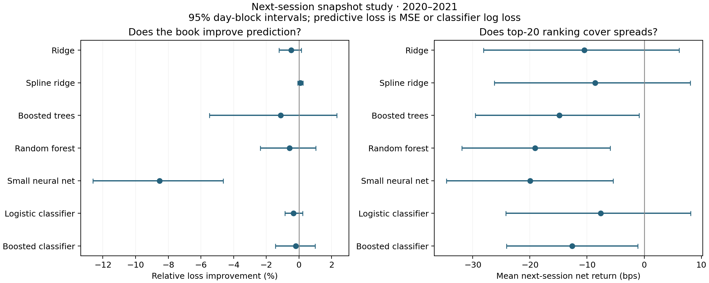

# Next-day snapshot reconstruction and ranking — 21 October 2026

The completed next-session study does not establish incremental predictive value from these book features, or a profitable top-20 rule after spreads. This corrects the horizon of the earlier minute study: those minute results were not an answer to the original next-day question. The conclusions below concern this bounded experiment, not every possible forecasting method.

## What was tested

Signals stop at 15:50. The primary target is **next trading day's 09:35–15:55 price return**. Secondary targets are today's 15:55 to next 09:35 (overnight), and today's 15:55 to next 15:55 (combined). These are observable near-open/near-close proxies, not auction returns. Daily book features summarize queue imbalance, endpoint flow, persistence, early/late pressure, spread-scaled imbalance, pressure with/without price movement, and market/sector pressure. Sampled endpoint flow is not reconstructed event OFI.

Five regressions and two direction classifiers each have a matched baseline and book version: 42 final fitted models. Baselines include return history, volatility, price, spread, depth, market/sector return context and trailing target means. Classifiers predict positive raw returns; they do not directly predict profit after costs. Settings were chosen on 2019 after fitting 2017–2018, then refitted through 2019 and evaluated on 2020–2021. Features use only matured outcomes and training-only preprocessing. At most two preset settings per family were considered. All forecasts and final model objects are retained locally.

The universe was chosen from 2017 coverage: 483 stocks, including 105 genuine ten-level names. The test sample contains 111,767 valid primary outcomes in 2020 and 69,524 in 2021, with 450 scored signal dates. Available names fall from 483 in 2020 to 380 in early 2021 and 271 by December; the archive is not a balanced panel. No test-coverage screen removes unavailable names from the original universe. The 2020–2021 extraction records 9,515 irregular stock-day grids, 1,221 shortened/exceptional sessions and 11 insufficient signal histories. The full year/target coverage is in [target_coverage.csv](full_study/next_day/target_coverage.csv).

## Primary predictive finding

Positive values below mean lower loss from adding book information to the matched model. Regression loss is MSE; classifier loss is log loss. Cross-stock losses are averaged within each day before inference, and 20-day circular blocks are resampled 2,000 times. Confidence intervals are individual 95% intervals; Holm p-values correct seven primary comparisons.

| Model | Book improvement in loss | 95% day-block interval | Holm p |
| --- | --- | --- | --- |
| Ridge | -0.484% | [-1.209%, +0.147%] | 0.933 |
| Spline ridge | +0.085% | [-0.063%, +0.241%] | 1.000 |
| Boosted trees | -1.111% | [-5.478%, +2.325%] | 1.000 |
| Random forest | -0.565% | [-2.372%, +1.037%] | 1.000 |
| Small neural net | -8.539% | [-12.614%, -4.639%] | 0.007 |
| Logistic classifier | -0.324% | [-0.853%, +0.224%] | 1.000 |
| Boosted classifier | -0.195% | [-1.429%, +0.991%] | 1.000 |

Only spline ridge has a positive pooled point estimate, about 0.085% relative MSE improvement, with an interval crossing zero. The small neural model deteriorates, but its fixed 30-iteration optimization limit was reached without convergence; this is evidence about this restricted implementation, not neural networks generally. No positive primary increment is established after correction. The matched ten-level ridge and boosting increments also have intervals crossing zero and Holm p=1.000; deeper summaries do not rescue this specification. Separate yearly estimates and the depth comparison are saved in [inference.csv](full_study/next_day/inference.csv) and [depth_inference.csv](full_study/next_day/depth_inference.csv).

## Simple controls matter

| Book model | Mean rank IC | Direction accuracy | MSE gain vs zero | Loss gain vs own-mean / prior |
| --- | --- | --- | --- | --- |
| Ridge | 0.0261 | 51.28% | -0.713% | +0.829% |
| Spline ridge | 0.0264 | 50.99% | -0.046% | +1.486% |
| Boosted trees | 0.0115 | 50.42% | -5.072% | -3.463% |
| Random forest | 0.0054 | 49.04% | -4.251% | -2.654% |
| Small neural net | 0.0016 | 49.97% | -18.302% | -16.490% |
| Logistic classifier | 0.0262 | 51.55% | — | -0.483% |
| Boosted classifier | 0.0076 | 49.55% | — | -2.694% |

The last column compares regressions with the stock's matured trailing 60-observation target mean (training mean fallback), and classifiers with the training positive-return frequency. Every regression's pooled next-session MSE is worse than a zero-return forecast, despite some improving on the noisier rolling-mean control. Direction accuracy near 50% and small positive rank correlations are not evidence of a usable trading edge. Training-mean, zero and rolling controls are retained in the daily control output; all model versions are in [model_summary.csv](full_study/next_day/model_summary.csv).

## Rigel's ranking idea

Ranking avoids treating an imperfect forecast as a precise return estimate, but it still needs useful ordering and enough realized movement to pay the spread. Top20 chooses the twenty largest absolute forecasts, uses their predicted signs and assigns each 1/20 of fixed gross notional. Classifier confidence is probability minus 0.5. The separate L10/S10 rule takes the highest ten and shorts the lowest ten at 1/20 each. Both choose names **before** checking future return availability. A selected missing outcome makes the day unscorable; it is not assigned zero return or replaced with another name.

The following are average basis points per portfolio holding cycle after crossing quoted entry/exit spreads, before fees, impact, financing and borrow costs. Book-model rows are all reported; none is selected using test profits.

| Book model | Next-session top20 | Next-session L10/S10 | Overnight top20 | Combined top20 |
| --- | --- | --- | --- | --- |
| Ridge | -10.50 | -13.27 | -4.42 | +1.46 |
| Spline ridge | -8.57 | -9.46 | -6.71 | +7.17 |
| Boosted trees | -14.84 | -9.12 | -27.04 | -7.68 |
| Random forest | -19.10 | -15.83 | -20.44 | -3.02 |
| Small neural net | -19.98 | -19.04 | -12.95 | -9.32 |
| Logistic classifier | -7.59 | -11.53 | -5.06 | +19.51 |
| Boosted classifier | -12.63 | -8.69 | -22.54 | +4.11 |

For the primary target, every baseline and book variant has a negative pooled net mean under both ranking rules. The book top20 variants are also all negative separately in 2020 and 2021. Spline ridge, for example, earns about 9.09 bps gross but loses 8.57 bps net per next-session cycle; ordering alone does not bridge the spread. Its paired improvement over the baseline top20 rule is about 5.09 bps with an interval crossing zero. All seven primary top20 book-minus-baseline intervals include zero.

Primary top20 comparisons use 435 common scorable days across all fourteen model variants, versus 450 prediction-scoring days. Common-day selection depends on future quote availability and can bias the economic sample; missing outcomes are not harmless cash. Complete unmatched records and exclusions remain local. [Portfolio summaries](full_study/next_day/portfolio_summary.csv) include individual intervals, yearly results and an additional 1 bp-per-side charge. [Paired portfolio increments](full_study/next_day/portfolio_increment.csv) are descriptive, not multiplicity-adjusted trading discoveries. Returns use exact arithmetic cash/share accounting for shorts and fixed initial gross notional. They are not annualized Sharpe ratios or compounded portfolio wealth. Combined cycles charge a fresh round trip, without netting consecutive exposures.

The earlier minute ranking study likewise found all 27 tested variants net negative, including explicit forecast-versus-spread gates; see [RANKING_REPORT.md](RANKING_REPORT.md). That result and the next-session result are separate tests.

## Secondary horizons

No secondary-target book increment passes its multiplicity correction.

| Target | Model | Book improvement in loss | 95% interval | Holm p |
| --- | --- | --- | --- | --- |
| overnight | Ridge | -0.087% | [-0.232%, +0.068%] | 1.000 |
| overnight | Spline ridge | -0.099% | [-0.219%, -0.007%] | 0.838 |
| overnight | Boosted trees | -1.584% | [-3.383%, +0.071%] | 0.840 |
| overnight | Random forest | -0.037% | [-0.625%, +0.723%] | 1.000 |
| overnight | Small neural net | -2.786% | [-5.054%, +0.486%] | 0.826 |
| overnight | Logistic classifier | -0.105% | [-0.418%, +0.182%] | 1.000 |
| overnight | Boosted classifier | -0.719% | [-1.845%, +0.300%] | 1.000 |
| combined | Ridge | -0.046% | [-1.143%, +0.752%] | 1.000 |
| combined | Spline ridge | +0.103% | [-0.114%, +0.251%] | 1.000 |
| combined | Boosted trees | -1.343% | [-5.199%, +0.954%] | 1.000 |
| combined | Random forest | -1.206% | [-2.979%, -0.062%] | 1.000 |
| combined | Small neural net | -0.971% | [-6.515%, +2.108%] | 1.000 |
| combined | Logistic classifier | +0.210% | [-0.420%, +0.825%] | 1.000 |
| combined | Boosted classifier | +0.356% | [-1.373%, +2.236%] | 1.000 |

One descriptive result deserves follow-up without being promoted to a discovery: combined-horizon logistic top20 with book features averages **+19.51 bps net per cycle**, with an individual 95% interval of [+2.01, +36.35] bps. Its baseline already earns +9.59 bps, and the paired book increment is +9.92 bps with an interval of [−9.17, +29.02] bps. The book variant averages +25.13 bps in 2020 and +13.58 bps in 2021, but these are not independent new validation samples after inspecting the pooled experiment. Its average net long exposure is 0.24, versus 0.92 for the baseline, so the comparison also changes directional exposure. The corresponding long10/short10 book portfolio is −0.88 bps per cycle. This is an exploratory candidate among many reported strategies, not demonstrated incremental book alpha; portfolio intervals are unadjusted for that search. A genuinely new evaluation period and verified corporate-action treatment would be needed before upgrading the claim.

These targets use unadjusted price returns. Absolute overnight log gaps of at least 0.20 are removed: 68 flagged test observations in 2020 and 8 in 2021. This is a crude contamination screen that also removes genuine large moves; it is not corporate-action adjustment. Dividends and corporate actions were not independently verified, so overnight/combined economic results are weaker evidence than the intraday primary test. Fourteen secondary increments receive a separate Holm correction, not the primary seven-test correction.

## Checks, limits and interpretation

All 29 research tests pass, including signal-cutoff invariance, matured labels, missing-session alignment, training-only preprocessing, missing classifier labels and explicit short cash accounting. All 42 saved models replay 97 sampled predictions each (4,074 total), with maximum absolute error 2.2e-16. Model convergence warnings are preserved in [implementation_manifest.json](full_study/next_day/implementation_manifest.json); the neural runs are optimization-limited. Primary sensitivity checks excluding absolute log returns >=0.10 or March 2020 do not reveal a positive increment with an individual interval excluding zero. These are descriptive robustness checks, not alternative selected primary samples.

The calendar is inferred from archive dates with at least 100 names; absent archive-wide sessions cannot be recovered. Static sector labels are not verified point-in-time; missing sectors map to Unknown. Future daily quality failures can remove targets even when the required execution quotes might otherwise exist. There is no independent dividends/corporate-action file, execution replay, borrow availability, or market-impact model. The archive was explored before this implementation, so 2020–2021 are held out from this code's fitting choices, not guaranteed untouched research data. Coarse snapshots cannot reproduce within-minute order events or trade classifications.

This is a useful, reproducible negative reconstruction and a bounded extension, not yet a distinct positive paper contribution. Daily imbalance prediction and portfolio sorts already appear in [Lu, Reinert and Cucuringu](https://arxiv.org/html/2209.10334); event-type OFI decomposition appears in [Sitaru, Calinescu and Cucuringu](https://papers.ssrn.com/sol3/papers.cfm?abstract_id=4572510). Our snapshot features cannot exactly reproduce either construction. See [the novelty review](NOVELTY_REVIEW.md) for overlap and the limits of the literature search. The defensible conclusion is that minute queue predictability does not automatically survive aggregation into these next-day forecasts, and selecting large forecasts does not establish net profitability. More model search on the same test period would require a new exploratory label, not a stronger holdout claim.

## Reproduce

Use the existing environment and raw-input path described in the original [report](REPORT.md). The minute raw-derived caches and archive inventories must exist first. Run, in order:

```sh
python daily_data.py
python next_day_study.py panel
python next_day_study.py fit
python depth_next_day.py
python summarize_next_day.py
python verify_next_day.py
python -m unittest discover
python report_next_day.py
```

Extraction/fitting stages resume existing files; remove or isolate stale outputs before changing a specification. Full daily summaries, input hashes, panel, models and forecasts stay local under `full_study/next_day/`; the research branch includes source, tests, compact aggregate results and the figure. Numerical fits use one thread. The daily panel is about 422 MB, and the observed fit process used about 1.4 GB RAM. No new event-data purchase is needed to reproduce this snapshot study.


