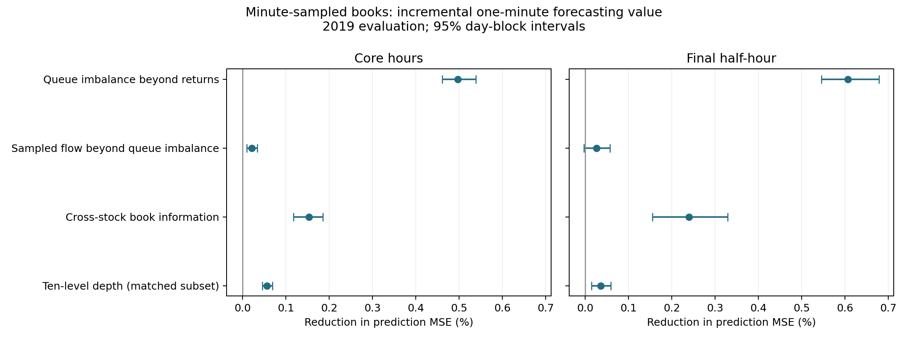

# Minute-sampled order books: reconstruction and closing-session study

**Completed research run; final review — 20 October 2026.**

This study uses the data already available. It does not depend on acquiring event data. Minute snapshots suffice for the book-state and endpoint-proxy questions below. They cannot reveal every addition, cancellation or execution between snapshots; exact event-OFI reconstruction would require event updates, not merely more days of the same snapshots. The original files are unchanged and no data was uploaded. It reconstructs a defensible snapshot-based experiment; it does not reproduce the original daily/overnight Sharpe claims or claim an exact event-OFI replication.

## What was actually run

The audit covers all 516 raw archives and the project's files. It found 1,693,301 dated members spanning 2007–2021. For the 2017–2019 study period, 377,826 stock-day files were considered. After training-coverage, validation and data-quality requirements, **483 stocks** have scored forecasts, including **105 with ten levels**. The primary one-minute evaluation contains **42,655,513 stock-minute forecasts** (one row per stock and decision time, not multiplied by the number of models). SPY and ten sector ETFs were audited but excluded from the stock universe. There are 246 evaluated trading dates. Exact per-stock date counts and observation counts are in `full_study/coverage.csv`.

The project occupied about 49 GiB before this run. Most space was consumed by derived tables and integrated-OFI files; the linked raw archives occupy another 9.006 decimal GB. More disk space did not imply more frequent observations. See [the full folder audit](LITERATURE_AND_AUDIT.md).

**Of four primary incremental comparisons, 3 show a positive equal-session MSE reduction with Holm-adjusted p<0.05. Of four closing-minus-core comparisons, 1 show a positive difference under that correction.** The numerical results below determine the interpretation; significance alone does not establish economic value or novelty.

## Main finding

There is a small, measurable book-state signal beyond return history. Best-queue imbalance and its change reduce one-minute prediction MSE by **0.497% in core hours and 0.607% in the final half-hour**. The closing advantage is **0.110 percentage points** (Holm-adjusted p=0.0075). Cross-stock book factors add **0.194%** on the equal-session measure; ten-level information adds **0.046%** on its matched subset. The sampled-flow increment is **0.023%**, with adjusted p=0.062, so it does not pass the primary 5% threshold.

This does **not** recover the original trading-alpha claim. For the cross-book model, the closing-session average signed midpoint return is about **+0.416 basis points**, but the observed bid/ask round-trip calculation is **−2.554 basis points**, before fees and other costs. Core-session quote results are also negative. Waiting one minute before entering nearly eliminates the queue-imbalance improvement (about **0.0012%** relative MSE reduction). The defensible conclusion is short-lived predictive information, not an established profitable strategy.

The result worth discussing with Mihai is therefore a narrowly stated closing-session comparison, with explicit return-history controls and a transparent snapshot-data limitation. Its novelty and stability across independent periods remain unestablished.

## Incremental forecasting results

Positive values are percentage reductions in mean squared prediction error relative to the comparator. These are relative MSE reductions, not Sharpe ratios or percentage returns. A 0.607% reduction means lowering an MSE of 1.000 to about 0.994, not predicting 60.7% of returns correctly. Each contrast uses identical observations for its two models. Deep comparisons use only genuine ten-level stocks. Each stock-day contributes equally within a session, then dates are averaged. Reported intervals are pointwise 95% circular twenty-day block-bootstrap intervals.

| comparison | session | effect | low | high |
| --- | --- | --- | --- | --- |
| book - returns | core | +0.4967% | +0.4605% | +0.5389% |
| book - returns | close | +0.6067% | +0.5453% | +0.6787% |
| cross - flow | core | +0.1529% | +0.1172% | +0.1853% |
| cross - flow | close | +0.2396% | +0.1552% | +0.3287% |
| deep - flow | core | +0.0563% | +0.0454% | +0.0686% |
| deep - flow | close | +0.0353% | +0.0143% | +0.0589% |
| flow - book | core | +0.0209% | +0.0089% | +0.0332% |
| flow - book | close | +0.0259% | -0.0034% | +0.0570% |



Model names: **returns** = own and market return history plus spread, depth and time-of-day; **book** adds best-queue imbalance and its change; **flow** adds sampled endpoint flow; **cross** adds market-average book variables excluding the target; **deep** adds ten-level mean queue/flow variables. “Cross” tests a simple market-factor representation, not every possible pairwise cross-impact network.

## The closing-session extension

Core observations have outcomes ending by 15:30. Closing observations start at or after 15:30 and end strictly before 16:00. Overlapping boundary intervals are excluded. The interaction is the closing-session proportional MSE improvement minus the core-session improvement, using matched stock-days. A positive interaction does not itself imply a positive absolute closing-session improvement; consult both session estimates above.

The overall primary effect gives the core and closing session equal weight before dividing by comparator loss. This is an intentional session-balanced estimand, not a minute-count-weighted trading result. Holm adjustment covers all eight primary tests below. Session-specific intervals above are not multiplicity-adjusted.

| comparison | session | effect | low | high | p_holm_primary |
| --- | --- | --- | --- | --- | --- |
| book - returns | equal_session | +0.5487% | +0.5047% | +0.5987% | 0.003998 |
| book - returns | close_minus_core | +0.1099% | +0.0631% | +0.1650% | 0.007496 |
| cross - flow | equal_session | +0.1938% | +0.1405% | +0.2475% | 0.003998 |
| cross - flow | close_minus_core | +0.0867% | +0.0157% | +0.1655% | 0.06447 |
| deep - flow | equal_session | +0.0457% | +0.0333% | +0.0608% | 0.003998 |
| deep - flow | close_minus_core | -0.0210% | -0.0436% | +0.0008% | 0.1289 |
| flow - book | equal_session | +0.0233% | +0.0048% | +0.0423% | 0.06197 |
| flow - book | close_minus_core | +0.0050% | -0.0200% | +0.0303% | 0.6877 |

## Forecasting is not profitability

The following are average signed log-return basis points per independent one-minute forecast. The quote calculation assumes a long buys at the observed ask and sells at the later bid; a short sells at the bid and buys back at the later ask. These are indicative quote-crossing calculations, not guaranteed fills, realized P&L, or a self-financing portfolio. No commissions, fees, latency slippage, market impact, borrow costs, or capacity constraints are included. The observed book quotes are not independently verified consolidated NBBO prices. Zero forecasts do not trade. Five-minute diagnostic round trips overlap and must not be added into a portfolio return.

| session | model | r2_vs_zero | gross_bps | quote_net_bps |
| --- | --- | --- | --- | --- |
| close | book | 0.00662 | 0.33944 | -2.63010 |
| close | cross | 0.00925 | 0.41603 | -2.55351 |
| close | flow | 0.00687 | 0.34918 | -2.62036 |
| close | mean | 0.00004 | 0.04002 | -2.92953 |
| close | returns | 0.00055 | 0.14604 | -2.82350 |
| close | zero | 0.00000 | 0.00000 | 0.00000 |
| core | book | 0.00473 | 0.32248 | -4.44057 |
| core | cross | 0.00646 | 0.37692 | -4.38613 |
| core | flow | 0.00494 | 0.32920 | -4.43386 |
| core | mean | -0.00001 | -0.00138 | -4.76443 |
| core | returns | -0.00024 | 0.14053 | -4.62252 |
| core | zero | 0.00000 | 0.00000 | 0.00000 |

The `r2_vs_zero` column is a fraction: 0.01 means a 1% reduction in squared error versus predicting zero. Statistical improvements between nested models can coexist with poor absolute forecasting or negative quote-cost results. The all-session summary above can differ slightly from the paired inference table, which additionally requires matched core and closing stock-days; it should not be used to recompute the primary paired contrasts. Deep models are omitted from this broad-universe economic table; their matched-subset summaries are saved in `full_study/summary.csv`.

## Contemporaneous construction check

These regressions explain the current minute's return with the current minute's endpoint-flow proxy. They do not forecast the future. Training/tuning dates remain chronological; current returns are never used as predictors in this diagnostic. “Deep-flow” adds deeper mean flow to level-one flow. The table averages per-stock 2019 R² values (with zero-return denominator), so its aggregation differs from the forward prediction table.

| universe | session | model | mean | median | count |
| --- | --- | --- | --- | --- | --- |
| broad | close | cross_flow | 49.96% | 51.86% | 483 |
| broad | close | own_flow | 43.76% | 44.60% | 483 |
| broad | core | cross_flow | 43.84% | 44.84% | 483 |
| broad | core | own_flow | 38.59% | 38.48% | 483 |
| deep_matched | close | cross_flow | 50.50% | 51.89% | 105 |
| deep_matched | close | deep_flow | 57.31% | 58.22% | 105 |
| deep_matched | close | own_flow | 41.82% | 42.10% | 105 |
| deep_matched | core | cross_flow | 45.40% | 46.56% | 105 |
| deep_matched | core | deep_flow | 56.20% | 56.14% | 105 |
| deep_matched | core | own_flow | 38.45% | 38.11% | 105 |

An explanatory relationship is expected partly because the proxy is explicitly constructed from price changes. It validates directional construction more than tradability. Its level cannot be directly compared with event-derived OFI studies.

## Robustness checks

The five-minute horizon and one-minute delayed-entry target test temporal persistence. The fresh-snapshot sample removes observations where the entire best quote has remained identical for at least five minutes. This is only an observable snapshot-staleness proxy; it cannot establish the age of unseen intervening quote events. These analyses were specified before the full results, but are secondary and not included in the eight-test primary multiplicity family.

| horizon | delay | sample | comparison | effect | low | high |
| --- | --- | --- | --- | --- | --- | --- |
| 1 | 0 | fresh | book - returns | +0.5487% | +0.5047% | +0.5987% |
| 1 | 0 | fresh | cross - flow | +0.1939% | +0.1405% | +0.2475% |
| 1 | 0 | fresh | deep - flow | +0.0457% | +0.0333% | +0.0608% |
| 1 | 0 | fresh | flow - book | +0.0233% | +0.0048% | +0.0423% |
| 1 | 1 | all | book - returns | +0.0012% | +0.0005% | +0.0020% |
| 1 | 1 | all | cross - flow | +0.0004% | -0.0006% | +0.0016% |
| 1 | 1 | all | deep - flow | -0.0019% | -0.0029% | -0.0010% |
| 1 | 1 | all | flow - book | -0.0009% | -0.0016% | -0.0001% |
| 1 | 1 | fresh | book - returns | +0.0012% | +0.0005% | +0.0020% |
| 1 | 1 | fresh | cross - flow | +0.0004% | -0.0006% | +0.0016% |
| 1 | 1 | fresh | deep - flow | -0.0019% | -0.0029% | -0.0010% |
| 1 | 1 | fresh | flow - book | -0.0009% | -0.0016% | -0.0001% |
| 5 | 0 | all | book - returns | +0.1198% | +0.1072% | +0.1344% |
| 5 | 0 | all | cross - flow | +0.0250% | +0.0031% | +0.0485% |
| 5 | 0 | all | deep - flow | +0.0045% | -0.0005% | +0.0098% |
| 5 | 0 | all | flow - book | +0.0026% | -0.0018% | +0.0073% |
| 5 | 0 | fresh | book - returns | +0.1198% | +0.1071% | +0.1344% |
| 5 | 0 | fresh | cross - flow | +0.0250% | +0.0031% | +0.0485% |
| 5 | 0 | fresh | deep - flow | +0.0045% | -0.0005% | +0.0098% |
| 5 | 0 | fresh | flow - book | +0.0026% | -0.0018% | +0.0073% |

### Post-result stability diagnostics

Additional diagnostics, added after seeing the primary results, varied the bootstrap block length to 5, 10 and 40 trading days and omitted each evaluation month in turn. These are sensitivity checks, not newly declared primary tests. The queue-imbalance closing advantage remains positive under every month omission (about 0.097–0.133 percentage points), and its pointwise interval stays above zero at every tested block length. The cross-stock closing advantage is less stable statistically: its five-day-block interval includes zero. The sampled-flow overall interval includes zero with forty-day blocks. These checks reinforce the distinction between the stronger queue-state result and the weaker flow/session claims. Full values are in `block_length_sensitivity.csv` and `leave_month_out_sensitivity.csv`.

## Stock-level variation

| comparison | session | stocks | positive_share | median_effect |
| --- | --- | --- | --- | --- |
| book - returns | close | 483 | 79.089% | 0.193% |
| book - returns | core | 483 | 96.480% | 0.173% |
| flow - book | close | 483 | 57.350% | 0.002% |
| flow - book | core | 483 | 53.830% | 0.000% |
| cross - flow | close | 483 | 97.516% | 0.231% |
| cross - flow | core | 483 | 97.101% | 0.140% |
| deep - flow | close | 105 | 66.667% | 0.014% |
| deep - flow | core | 105 | 80.000% | 0.017% |

Positive share is the fraction of stocks with lower aggregate 2019 squared error under the added features. It is descriptive, not a fraction of individually significant results. The median stock effect differs from the primary ratio of average stock-day losses; the latter gives larger loss levels more influence on the proportional effect even though stock-day losses are equally averaged.

## Open-to-current return control (secondary)

Own-stock and leave-own-out market returns since the 09:30 snapshot are added to every fitted forward model. This specification was motivated by the end-of-day reversal literature before inspecting the primary effects. It uses the same chronological split, model family and one-minute target, in a separate output directory. Its eight adjusted tests form a separate sensitivity family; they do not replace or enlarge the primary family. These are the same evaluation dates, not an independent replication.

| comparison | session | effect | low | high | p_holm_sensitivity |
| --- | --- | --- | --- | --- | --- |
| book - returns | core | +0.4946% | +0.4586% | +0.5365% | — |
| book - returns | close | +0.6047% | +0.5442% | +0.6750% | — |
| book - returns | equal_session | +0.5466% | +0.5032% | +0.5964% | 0.003998 |
| book - returns | close_minus_core | +0.1101% | +0.0651% | +0.1635% | 0.004998 |
| cross - flow | core | +0.1529% | +0.1188% | +0.1845% | — |
| cross - flow | close | +0.2409% | +0.1553% | +0.3300% | — |
| cross - flow | equal_session | +0.1945% | +0.1415% | +0.2480% | 0.003998 |
| cross - flow | close_minus_core | +0.0881% | +0.0174% | +0.1651% | 0.05997 |
| deep - flow | core | +0.0561% | +0.0451% | +0.0686% | — |
| deep - flow | close | +0.0369% | +0.0153% | +0.0606% | — |
| deep - flow | equal_session | +0.0464% | +0.0336% | +0.0617% | 0.003998 |
| deep - flow | close_minus_core | -0.0192% | -0.0414% | +0.0028% | 0.2019 |
| flow - book | core | +0.0230% | +0.0109% | +0.0356% | — |
| flow - book | close | +0.0281% | -0.0009% | +0.0597% | — |
| flow - book | equal_session | +0.0254% | +0.0071% | +0.0446% | 0.02599 |
| flow - book | close_minus_core | +0.0051% | -0.0210% | +0.0312% | 0.6832 |

The queue-state finding is essentially unchanged: the additional control yields about **0.495% core** and **0.605% closing** MSE improvement, with a **0.110 percentage-point** closing advantage (sensitivity-family adjusted p=0.0050). Cross-stock and depth improvements also persist. The tiny sampled-flow increment passes the secondary family's threshold (p=0.026) although it did not pass the primary family's threshold; this is specification sensitivity, not grounds to replace the primary conclusion. Quote-cost results remain negative. The secondary sample contains 42,655,155 one-minute observations, 358 fewer than the primary sample because the added opening-price controls require valid observations.

## Verification

Seventeen correctness tests pass. Saved coefficients and preprocessing were replayed for five stocks spanning both depth types: 78 primary model/horizon specifications reproduced daily observation counts, squared errors, and independently expressed bid/ask cost calculations. The replay shares feature construction with the main pipeline, so it is a check of saved-model and scoring consistency, not an independent reconstruction of every raw-data transformation. The separate open-to-current control passed another 26 saved-model replays. Full-result integrity checks cover all 483 stocks in each run: finite outputs, equal observations across models, matching target denominators, unique score keys, zero-baseline identities, training thresholds, and quote costs no better than corresponding midpoint returns. Detailed check outputs are saved alongside the tables.

The main 483-stock model evaluation took approximately 21 minutes and used less than 1 GiB peak resident memory. Extraction processed one archive at a time. No packages were installed, raw data was not uploaded, and historical project results were not overwritten.

## Data and methodology

1. **Raw reconstruction.** Read each selected daily raw book directly. Column names are normalized. Locked/crossed/nonpositive/sentinel or nonfinite quote/queue values become invalid rather than zero signals. Exact full-session minute grids are required. All missing, malformed and shortened sessions are logged. Forecast labels with absolute log returns of 0.2 or more are excluded by a fixed extreme-move filter; this could also exclude genuine extreme events.
2. **Observed book state.** Best-level imbalance is `(bid size − ask size)/(bid size + ask size)`. Its first difference and log depth are computed within the day. Extra levels are equal-weight summaries; no fabricated deep data or full-sample PCA is used.
3. **Sampled flow.** Use the canonical signed bid/ask endpoint change with prior queue sizes when an old quote disappears. Divide by current mean queue depth at that level and apply fixed `tanh(flow/10)` to limit extreme inputs. This is deliberately named a proxy: it is not the sum of unseen event contributions. The scale transformation is fixed, not selected on test results.
4. **Chronology.** Train on 2017, select one ridge penalty per stock/model/horizon using 2018 MSE, refit on 2017–2018, evaluate 2019. Scaling and 0.1/99.9-percentile feature clipping are fit only on the applicable training portion. No target is standardized using future information. Models have one intercept. Zero and fitted training-mean forecasts are explicit baselines.
5. **Universe.** Market-factor membership requires 70,000 valid one-minute return observations in 2017 alone. Forecast fitting additionally requires at least 50,000 training and 10,000 validation observations. No 2019 coverage threshold selects survivors. Availability still changes with observed missing/delisted names, and the source archive's initial stock selection remains a limitation.
6. **Dependence.** Aggregate paired errors across stocks by day and resample calendar-day blocks jointly across the cross-section and both sessions. Seed 279, 2,000 draws, twenty-day circular blocks. The analysis does not pretend millions of overlapping stock-minutes are independent observations.
7. **Resource control.** Sequential archive extraction and sequential stock fits; numerical libraries limited to one thread. A per-stock extraction cap prevents accidental multi-gigabyte decompression. Original archives, old code, and old results are preserved.

Quality summary (stock-days considered; invalid snapshot counts are within successfully parsed days):

| status | stock_days | invalid_snapshots |
| --- | --- | --- |
| irregular_time_grid | 2318 | 0 |
| ok | 371471 | 653 |
| short_or_exceptional_session | 4037 | 0 |

Three recurring irregular-grid dates identified in early inspection were 2019-01-09, 2019-03-08 and 2019-09-18. The complete exclusion list, including stock-specific irregular files, is in `full_study/excluded_days.csv.gz`. Half days are excluded rather than padded into a fake closing session. Missing or excluded test observations do not constitute zero returns.

## Interpretation and limits

This is a substantial completed empirical study, not proof that any one model exhausts the information in these books. It asks whether a small, interpretable set of observed book-state and sampled-flow variables adds to return history under a fixed split. It cannot identify every nonlinear signal, recover hidden order events, prove causality, or generalize one evaluation year to every market regime.

The 2019 sample was held out by this implementation, but previous project analyses may already have used it. It therefore is not an untouched research holdout. Frozen choices and a small model family reduce flexibility; they cannot erase the project's previous exploration. The same fitted models are evaluated in both sessions; the closing comparison is not a causal estimate or a model separately optimized for the close. The cross-stock features are market averages rather than an unrestricted multi-asset LASSO. Deep features are equal-weight summaries rather than the paper's PCA. Those choices keep this study simple and define its scope.

The local source already had the sign correction, and some local date-index code differs from the old remote audit. Old caches and old manuscript claims are not treated as one verified pipeline. The large processed tables were audited but not trusted as new empirical evidence. The new results do not validate the historical Sharpe values.

Publication novelty is not established. The existing literature already studies queue imbalance, multilevel flow, and cross-impact. The most useful new question here is the incremental closing-session contrast on sampled books. A favorable finding would still require independent-period replication and a stronger execution/data-quality case before being presented as a trading strategy or publication-ready discovery.

## Deliverables and reproduction

- [Primary protocol](PRIMARY_PROTOCOL.md), [protocol including secondary control](PROTOCOL.md), [folder/literature audit](LITERATURE_AND_AUDIT.md).
- `study.py`: inventory, raw extraction, market factors, chronological models and contemporaneous diagnostic.
- `summarize_study.py`: paired effects, bootstrap intervals, multiplicity correction and figure.
- `report_study.py`: this report from saved result tables.
- `full_study/archives.csv`, `members.csv.gz`, per-stock audit files with input SHA-256 hashes.
- `full_study/coverage.csv`, `summary.csv`, `inference.csv`, `daily_paired_losses.csv.gz`, `scores/` and fitted-penalty records.
- Correctness tests cover directional signs, prior queue sizes, loss under sampling, future perturbations, target timing, no overnight labels, own-stock exclusion, missing quotes, known-signal recovery, block inference and Holm correction.

From this folder, using the existing environment:

```sh
../.venv/bin/python -m unittest -v
../.venv/bin/python study.py audit
../.venv/bin/python study.py extract
../.venv/bin/python study.py market
../.venv/bin/python study.py evaluate
../.venv/bin/python summarize_study.py
../.venv/bin/python session_control.py
../.venv/bin/python summarize_session_control.py
../.venv/bin/python verify_saved_models.py
../.venv/bin/python verify_saved_models.py --session-control
../.venv/bin/python audit_results.py
../.venv/bin/python inference_sensitivity.py
../.venv/bin/python report_study.py
```

Extraction and evaluation skip completed stock files. To change features, dates or model specification, use a fresh output directory or deliberately remove only the new generated caches/results; never combine incompatible cached runs. No external repository was modified. Event-data acquisition is optional future work, not a prerequisite for the completed snapshot study.
