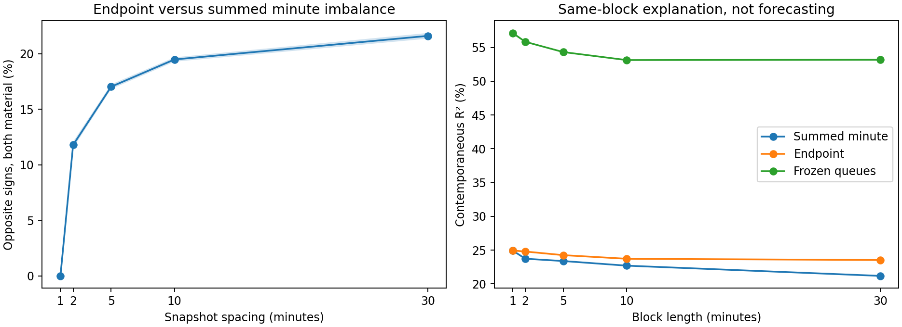

# What snapshot sampling does to order flow imbalance

Brendan Connelly and Rigel Mummers  
21 October 2026

## Abstract

We study a measurement problem that came out of trying to reproduce order-flow imbalance results with minute snapshots. Applying the usual quote-transition formula to a block’s endpoints does not generally give the same result as summing the transitions observed inside it. Across 483 US stocks, the two measures have opposite signs in 17.03% of materially nonzero five-minute comparisons in 2019, with a 95% interval of 16.82–17.24%. The rate reaches 21.61% at thirty minutes. We give an exact expression for the difference and show why a high contemporaneous R² need not reveal it. A frozen-queue control explains 54.32% of five-minute price variation, although bounding ordinary endpoint OFI raises its fit to 49.88%. Adding either the minute sum or endpoint OFI does not improve our controlled five-minute forward forecast. These results support a narrower conclusion about measurement and interpretation; they do not establish a profitable signal or measure the error relative to event-level OFI.

## 1 Why we looked at this

We started by trying to understand how much of the earlier OFI evidence we could reproduce with the data we actually had. The archive contains snapshots at one-minute intervals, mostly with one book level and sometimes with ten. That makes the distinction between an observed quote change and an order-book event important from the beginning.

Cont, Kukanov and Stoikov [1] define OFI by adding contributions from individual events. Their construction is additive over time. The problem we examine arises when intermediate observations are discarded and the same formula is applied once to the remaining endpoints. We wanted to know how much this substitution changes the measured pressure, and whether the usual price-fit check would make the change obvious.

This is not a new objection to snapshot data. Su et al. [2] already discuss changes missed between observations and propose generalized OFI using deeper book information. Our question is more specific: on exactly the same observed paths, how often does endpoint substitution change the answer, and what can explanatory fit tell us about that difference? We have not implemented or tested their generalized estimator here.

## 2 Data and comparison

We use 483 stocks selected by coverage in 2017 and retain their available minute observations through 2019. The primary comparison contains 25,475,162 valid five-minute windows across 358,807 stock-days. Blocks are nonoverlapping, start at 10:00, and end by 15:55. Shortened and exceptional sessions were excluded upstream. A further 135 candidate five-minute windows fail the within-block validity or extreme-return checks. The one-, two-, ten- and thirty-minute grids provide scale checks; shifting the five-minute grid by two minutes provides a phase check.

Every comparison uses the best bid and ask, including for stocks with ten-level source files. We require valid quotes throughout each block and use the same starting mean displayed depth as the denominator for both measures. We do not normalize each minute separately before adding it. Most importantly, the minute sum is only a finer observed reference. It is not event OFI, and this experiment cannot tell us what happened between minute observations.

<!-- pagebreak -->

## 3 What gets lost at the endpoints

Let xⱼ contain the bid and ask prices and sizes at observation j. Write e(xⱼ₋₁,xⱼ) for the usual signed quote-transition contribution [1]. For a block with n transitions and starting mean depth D₀, we compare

$$F = Σⱼ₌₁ⁿ e(xⱼ₋₁,xⱼ) / D₀,     C = e(x₀,xₙ) / D₀.$$

F keeps the observed transitions; C keeps only the endpoints. There is no reason for them to coincide once prices move within the block. This is true even on a monotone price path: several upward bid transitions count several queues, while the endpoint calculation counts only the last one.

The difference has a simple exact expression. For one bid-side transition, define

$$B(p₀,q₀;p₁,q₁) = q₁ 1[p₁ ≥ p₀] − q₀ 1[p₁ ≤ p₀].$$

Checking the up, down and unchanged cases gives

$$B = (q₁ − q₀) + q₀ 1[p₁ > p₀] − q₁ 1[p₁ < p₀].$$

The size differences telescope. The error from replacing the sum by one endpoint contribution is therefore

$$Eᴮ = Σⱼ₌₁ⁿ {qⱼ₋₁ 1[pⱼ > pⱼ₋₁] − qⱼ 1[pⱼ < pⱼ₋₁]}$$
$$     − q₀ 1[pₙ > p₀] + qₙ 1[pₙ < p₀].$$

Apply the same expression to negative ask prices and ask sizes to obtain Eᴬ. Then F − C = (Eᴮ − Eᴬ)/D₀. Flat price paths have zero error even when sizes change. The identity is algebraic; it does not require a model for order arrivals.

It also makes the identification problem concrete. Keep bid size equal to q. The paths p, p+δ, p+2δ, p and p, p−δ, p−2δ, p have identical endpoints but summed bid contributions +q and −q. Hold the ask fixed above both paths and the net contributions have the same ambiguity. Any endpoint-only estimate must have an absolute error of at least q on one of the two paths. Additional assumptions could make an estimator useful, but endpoints alone cannot recover both sums.

### Why explanatory fit does not settle the issue

Consider a deliberately simple control: independent N(0, σ²) minute log returns with σ > 0, equal fixed queue sizes, and bid and ask prices at fixed proportions around a positive midpoint. The normalized fine measure is 2Σsign(Xⱼ); the endpoint measure is 2sign(ΣXⱼ). Both have population contemporaneous OLS R² = 2/π, approximately 63.66%, for every block length. Yet their sign-disagreement probability approaches

$$arccos(√(2/π)) / π ≈ 20.60%.$$

For the first result, Cov(ΣXⱼ,Σsign(Xⱼ)) = n E|X|. For the second, the joint central limit theorem gives limiting correlation √(2/π), and the bivariate Gaussian sign formula gives the expression above. A simulation of 100,000 paths with 1,001 increments gives 20.52% disagreement.

This is an illustration of what the statistics can do, not a realistic model of order-book dynamics. Price changes remain in both features. The point is that equally high fit can coexist with materially different measured pressure.

<!-- pagebreak -->

## 4 Results

We call a comparison material when both |F| and |C| exceed 0.1 starting-depth units. In 2019 this retains 95.91% of valid five-minute windows. We first average each stock’s disagreement rate within a date, then average dates equally. The intervals below use 2,000 circular bootstrap draws of 20-day blocks, resampling dates jointly across stocks.

Five-minute sign disagreement is 17.03% in 2019, compared with 15.98% in 2017 and 17.08% in 2018. Moving the grid two minutes gives 17.27%. The effect appears in both source-depth groups and every stock with a reported rate. At thirty minutes it reaches 21.61%. In the 2019 five-minute sample, 1,377,269 of 8,091,184 material comparisons have opposite signs; that pooled ratio is slightly different from our equal-stock and equal-day estimate.

*Figure 1. Results for 2019. Left: opposite signs conditional on both measures exceeding 0.1 in absolute value; shading gives 95% day-block intervals. Right: chronological test-period R² for linear models using the untransformed measures. These are explanations of the current block, not forecasts. The bounded-transform comparison below is important for interpreting the right panel.*

For the explanatory models, we train in 2017, select ridge strength in 2018, refit through 2018 and evaluate in 2019. Clipping and scaling are fitted on training data. R² is one minus the ratio of equal-stock and equal-day model MSE to a training-mean benchmark. The fit sample includes all eligible windows, not just material comparisons.

| Five-minute explanatory feature | 2019 R² |
|---|---:|
| Summed minute increments F | 23.38% |
| Endpoint contribution C | 24.25% |
| Endpoint contribution with queue sizes frozen at the start | 54.32% |
| tanh(C), fixed scale one | 49.88% |
| Sign of the current block return | 52.49% |

Freezing the sizes removes their within-block changes but retains the observed bid and ask price moves. Its 54.32% fit therefore does not establish independent flow information. There is also an important qualification: after seeing the raw comparison, we tested fixed tanh and sign transformations. Bounding endpoint OFI raises its fit to 49.88%. Much of the raw gap reflects functional form, so we should not interpret the whole difference between 24.25% and 54.32% as an economic effect of removing queue changes. The return-sign feature intentionally contains the outcome and is only a diagnostic benchmark. All transformation variants are reported in the supporting tables.

<!-- pagebreak -->

## 5 What we think the results support

The forward test gives a different picture. We forecast the following five-minute return using current and previous block returns, current spread, depth and queue imbalance, and trailing five- and thirty-minute returns. Adding F or C slightly worsens baseline MSE, by 0.0046% and 0.0036%, respectively. These are economically tiny changes. The four primary paired loss comparisons use identical windows and receive Holm correction; neither forward addition gives a positive gain. The distinction between contemporaneous explanation and forecasting is already important in OFI research [3]. We are not claiming to introduce it here.

What we do find is a substantial disagreement between two ways of constructing a snapshot measure, even though both can fit the current price move well. That is worth reporting because the calculations can otherwise look like interchangeable implementations of the same variable. The relevant failure is the endpoint substitution, not time aggregation of correctly retained increments.

The practical fix is modest. Before dropping intermediate observations, save summed bid and ask contributions, the depth sum and the number of increments. Adjacent summaries can then be added, with shared boundaries checked to avoid missing or double-counting transitions. Our implementation reproduces direct aggregation and rejects gaps. This preserves information already observed; it does not recover events the snapshots missed.

We also checked whether numerical precision could explain the result. The cached queue sizes are reconstructed from float32 log-depth and imbalance. In an audit of 18 original stock-day files, four exact zero flows became tiny nonzero cached values. The largest sampled normalized flow error was 0.000122. We therefore report thresholds of 0.001, 0.01 and 0.1, and use the last for the main sign comparison. At 0.001 the five-minute disagreement rate is 17.91%, so the material threshold does not create the finding. This audit is a sample check, not a universal error bound. The aggregation identity was checked across eligible blocks, and 210 saved models were replayed against 7,560 stock-day losses; all 17 relevant implementation and statistical tests pass.

There are limits we cannot remove with this archive. One-minute observations cannot validate event-level OFI or quantify sub-minute information loss. The stock archive may have survivorship selection. We had already examined these years in earlier work, so chronological separation does not make 2019 an untouched research holdout. The transformation checks were added after seeing the initial fit comparison. Finally, neither this evidence nor the elementary identities establish that the result is new to the literature.

Our conclusion is that endpoint-based snapshot OFI needs a measurement check alongside its price-fit statistics. The evidence here is enough to make that concern concrete. Whether the combination of the empirical audit, identification argument and implementation is a separate contribution still needs to be assessed against the closest prior work, particularly generalized snapshot OFI [2]. We would not present this as a new trading result.

## References

[1] Cont, R., Kukanov, A., and Stoikov, S. (2014). The Price Impact of Order Book Events. *Journal of Financial Econometrics*, 12(1), 47–88. https://arxiv.org/abs/1011.6402

[2] Su, Y., Sun, Z., Li, J., and Yuan, X. (2021). The Price Impact of Generalized Order Flow Imbalance. arXiv:2112.02947. https://arxiv.org/abs/2112.02947

[3] Cont, R., Cucuringu, M., and Zhang, C. (2023). Cross-impact of order flow imbalance in equity markets. *Quantitative Finance*. https://arxiv.org/abs/2112.13213

Code, full specification, uncertainty intervals, all sensitivity results and verification records: https://github.com/RM1505/math279_project/tree/research/ofi-snapshot-study-2026/replication_2026
